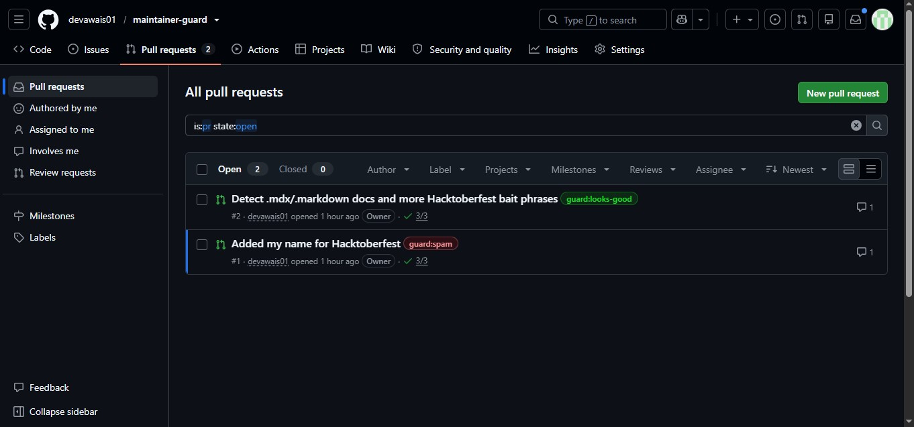
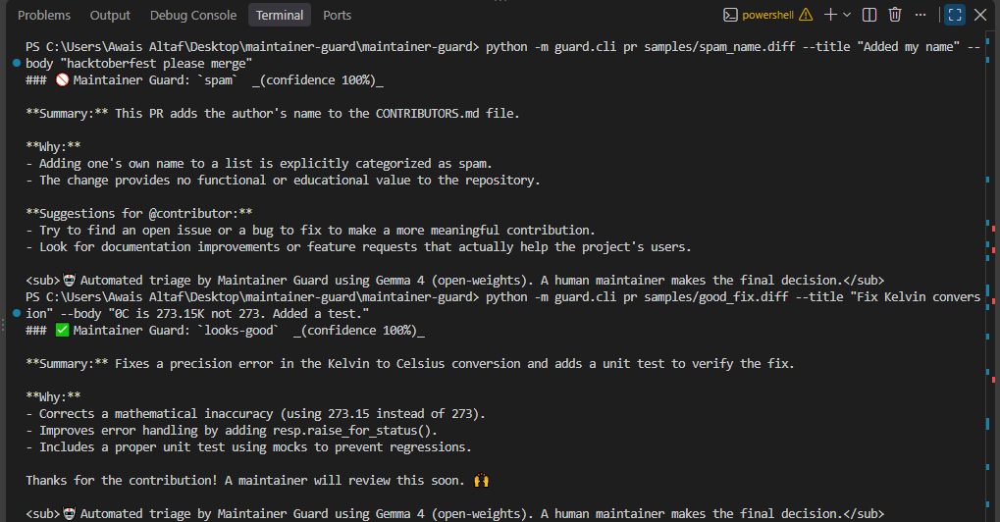
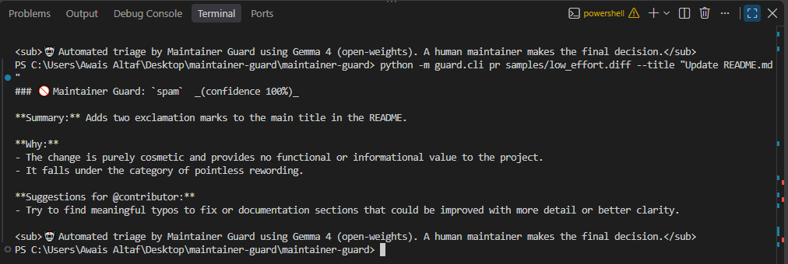

# 🛡️ Maintainer Guard

**Gemma 4-powered triage for open-source maintainers.**
A GitHub Action that automatically reviews every new pull request and issue, so maintainers spend their time on real contributions instead of Hacktoberfest spam.


-blue)


> Built at **Hacktoberfest Hack Day Lahore × AWS Student Builder Group, Virtual University of Pakistan** (17 Oct 2026).
> Entered in **Best Use of Gemma 4** (Google DeepMind) and **Best Open-Source AI Project** (DigitalOcean).

---

## 📸 It works: real results

### Live on GitHub: same bot, different verdicts

Two pull requests opened on this repository. Maintainer Guard ran automatically on each one and labeled them within about 40 seconds, with no human involved:



| PR | What it changed | Verdict |
|---|---|---|
| [#1](https://github.com/devawais01/maintainer-guard/pull/1) "Added my name for Hacktoberfest" | Adds a name to `CONTRIBUTORS.md` | 🚫 `guard:spam` |
| [#2](https://github.com/devawais01/maintainer-guard/pull/2) "Detect .mdx/.markdown docs and more Hacktoberfest bait phrases" | A real improvement to the spam detector | ✅ `guard:looks-good` |

Open either PR to read the bot's full comment.

**A real catch during development:** in PR #2, the bot's review advised running a linter or test to make sure the edit didn't break the script's syntax. The first version of that PR *did* have an indentation error, which the test suite then caught. The AI review flagged exactly the right risk.

### Local run: spam vs. a genuine fix

Gemma 4 explains **why** it decided, and is specific about what the change does:



- **Adding a name to CONTRIBUTORS.md** → 🚫 `spam`, with suggestions on how to contribute meaningfully.
- **Fixing a Kelvin→Celsius bug (273 → 273.15) with a unit test** → ✅ `looks-good`. Gemma noticed the math fix, the added `raise_for_status()`, *and* the mocked unit test.

### Local run: cosmetic change



- **Adding "!!" to a README title** → 🚫 `spam`: purely cosmetic, no value.

---

## The problem

Every October, open-source maintainers are flooded with pull requests that:
- add someone's name to a contributors list,
- change one word or add punctuation in a README,
- reformat whitespace,

all just to earn Hacktoberfest credit. At the same time, real users file bug reports that are only a blurry screenshot and the words "not working."

Maintainers burn hours triaging both, and it's a well-known cause of burnout. Every minute spent closing spam is a minute not spent reviewing real contributions.

## What Maintainer Guard does

It runs **automatically on every new PR and issue**. Nobody has to click anything.

### 🚫 1. Pull-request triage
1. Fetches the PR's diff and description.
2. A deterministic script computes **hard facts** the author can't argue with: Are only docs changed? Only a names list? Only whitespace? How big is the change? Is the description begging for a merge?
3. **Gemma 4** reads the diff plus those facts and classifies the PR:

| Label | Meaning |
|---|---|
| 🚫 `guard:spam` | No real value: name lists, whitespace, pointless rewording |
| ⚠️ `guard:low-effort` | Tiny, harmless, little value |
| 🛠️ `guard:needs-work` | A real attempt, but with problems (bugs, no tests, unclear) |
| ✅ `guard:looks-good` | Meaningful and ready for human review |

4. Applies the label and posts a **kind, specific comment**: a summary for the maintainer, the reasons, and suggestions for the contributor.
5. *(Optional)* auto-closes spam above a confidence threshold.

### 🔍 2. Screenshot → structured bug report
When an issue contains screenshots, Gemma 4's **vision** reads the image (error messages, stack traces, OS/browser/version, UI state) and posts a structured bug report:
- suggested clear title
- exact error text read from the image
- environment
- steps to reproduce
- expected vs. actual
- likely cause (for maintainers)
- missing info to ask the reporter

## How it works

```
 New PR / issue ──► GitHub Action (Maintainer Guard)
                         │
          ┌──────────────┴───────────────┐
          ▼                              ▼
   Pull request                   Issue with screenshots
   1. Fetch diff + metadata       1. Find image links in the issue
   2. Script computes hard facts  2. Download screenshots
      (docs-only? name-list only?  3. Gemma 4 VISION reads the image:
       whitespace-only? size?)        error text, environment, UI state
   3. Gemma 4 judges the change   4. Writes a structured bug report
      using those facts as ground     (steps, expected/actual, cause,
      truth                           missing info)
   4. Label + comment (+ optional  5. Label guard:bug-report + comment
      auto-close of high-confidence
      spam)
```

**Why a hybrid design?** Rules alone can't tell a real typo fix from pointless rewording, and an LLM alone can be talked into anything by a cleverly written PR description. So the script provides facts, Gemma provides judgement, and the code only acts on a fixed set of allowed outcomes.

## Why Gemma 4

- **Multimodal in one model:** the same open model reads code diffs (text) *and* bug screenshots (images).
- **Open weights:** maintainers can self-host it so repository data never has to leave their own infrastructure. That matters for open-source projects and companies that can't send code to a closed vendor.
- **Light enough to run on every PR:** `gemma-4-26b-a4b-it` is a mixture-of-experts model with about 4B active parameters, so it's fast and cheap.

Default model: `gemma-4-26b-a4b-it` via the Gemini API. Switch to `gemma-4-31b-it` with the `model` input.

## 🔒 Safety by design

- **Prompt-injection resistant:** PR and issue text is wrapped and marked as untrusted, and the model is told to ignore any instructions inside it. Even if the model were fooled, the code **only accepts the four allowed verdicts**. Anything else (e.g. `"merge-immediately"`) falls back to `needs-work`. This is covered by a unit test.
- **Never runs contributor code:** uses `pull_request_target` but only checks out the base repository, never the PR branch.
- **Humans decide:** it labels and comments by default. Auto-closing spam is **off** unless enabled, and then only above a confidence threshold (default 90%).
- **Never breaks CI:** if the model or API fails, the job logs a warning and exits cleanly.
- **No comment spam:** re-runs edit the bot's existing comment instead of posting new ones.
- **Skips bots**, and skips owners/members/collaborators by default.

## 🚀 Quick start (2 minutes)

1. Get a free Gemini API key at [Google AI Studio](https://aistudio.google.com/apikey).
2. In your repo: **Settings → Secrets and variables → Actions → New repository secret** → name it `GEMINI_API_KEY`.
3. **Settings → Actions → General → Workflow permissions** → **Read and write permissions** → Save.
4. Add `.github/workflows/maintainer-guard.yml`:

```yaml
name: Maintainer Guard
on:
  pull_request_target:
    types: [opened, edited, synchronize, reopened]
  issues:
    types: [opened, edited]
permissions:
  contents: read
  issues: write
  pull-requests: write
jobs:
  triage:
    runs-on: ubuntu-latest
    steps:
      - uses: devawais01/maintainer-guard@main
        with:
          gemini_api_key: ${{ secrets.GEMINI_API_KEY }}
```

That's it. The next PR or issue gets triaged automatically.

### Options

| Input | Default | What it does |
|---|---|---|
| `model` | `gemma-4-26b-a4b-it` | Gemma 4 model id |
| `close_spam` | `false` | Auto-close PRs judged spam |
| `close_threshold` | `0.9` | Minimum confidence to auto-close |
| `include_maintainers` | `false` | Also triage PRs from owners/members |
| `dry_run` | `false` | Log decisions only; no labels or comments |

## 💻 Try it locally (no GitHub needed)

```bash
pip install -r requirements.txt

# macOS/Linux
export GEMINI_API_KEY=your_key
# Windows PowerShell
$env:GEMINI_API_KEY="your_key"

# Pull-request triage on sample diffs
python -m guard.cli pr samples/spam_name.diff --title "Added my name" --body "hacktoberfest please merge"
python -m guard.cli pr samples/good_fix.diff --title "Fix Kelvin conversion" --body "0C is 273.15K not 273. Added a test."
python -m guard.cli pr samples/low_effort.diff --title "Update README.md"

# Screenshot → bug report
python -m guard.cli screenshot path/to/error_screenshot.png --title "not working"
```

## 🧪 Tests

```bash
pip install pytest && pytest -q
```

The tests mock Gemma, so they run offline and in CI on every push. They cover:
- diff parsing
- the deterministic heuristics (name-list, docs-only, whitespace-only)
- robust JSON extraction from model replies
- comment rendering
- the guarantee that an injected or malformed verdict can't trigger an unlisted action

## 📁 Project structure

```
action.yml              # the GitHub Action definition (composite action)
guard/
  main.py               # Action entry point: dispatches PR vs issue events
  pr_triage.py          # PR prompt, verdict validation, comment rendering
  issue_triage.py       # screenshot → structured bug report
  heuristics.py         # deterministic signals + image link extraction
  gemma.py              # Gemma 4 client (Gemini API REST) + robust JSON parsing
  github_api.py         # labels, comments (upsert), close
  cli.py                # local runner for testing and demos
samples/                # example diffs: spam, low-effort, genuine fix
tests/                  # offline unit tests
docs/screenshots/       # screenshots used in this README
.github/workflows/
  maintainer-guard.yml  # runs the bot on this repo
  tests.yml             # runs the test suite on every push/PR
```

## 🛠️ Tech stack

- **Gemma 4** (`gemma-4-26b-a4b-it`), open-weights, via the **Gemini API**
- **Python 3.12** (only dependency: `requests`)
- **GitHub Actions** (composite action)
- **GitHub REST API**
- **pytest** for tests

## 🗺️ Roadmap

- **Self-hosted mode:** point at a local Ollama Gemma 4 endpoint, so no data leaves the maintainer's machine
- **Duplicate-issue detection** using screenshot + text similarity
- **Weekly digest** for maintainers: what was triaged, how much time it saved
- **Repo-specific rules:** let maintainers describe what counts as low-effort for *their* project in a config file

## 👥 Team

Built by **[@devawais01](https://github.com/devawais01)** at Hacktoberfest Hack Day Lahore 2026.

## 📄 License

[MIT](LICENSE): free to use, modify and share.
